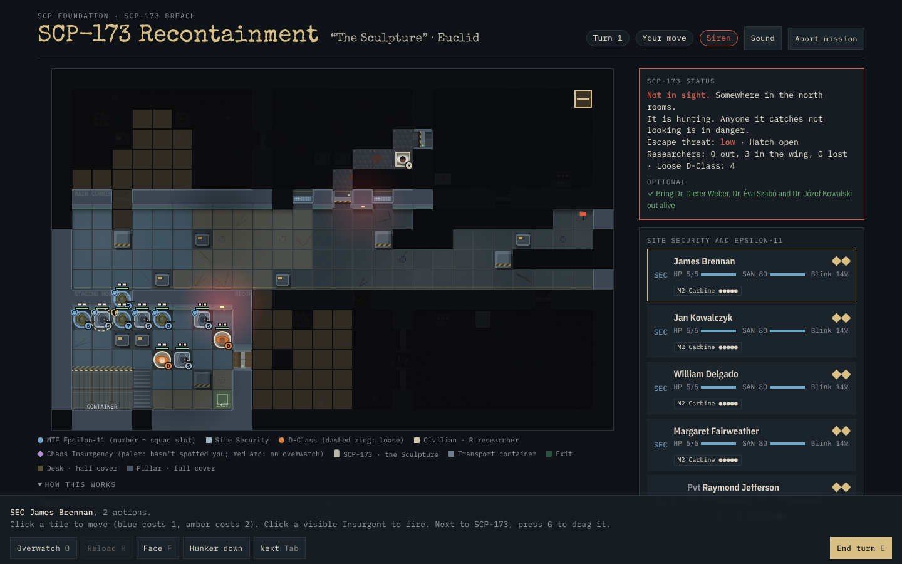
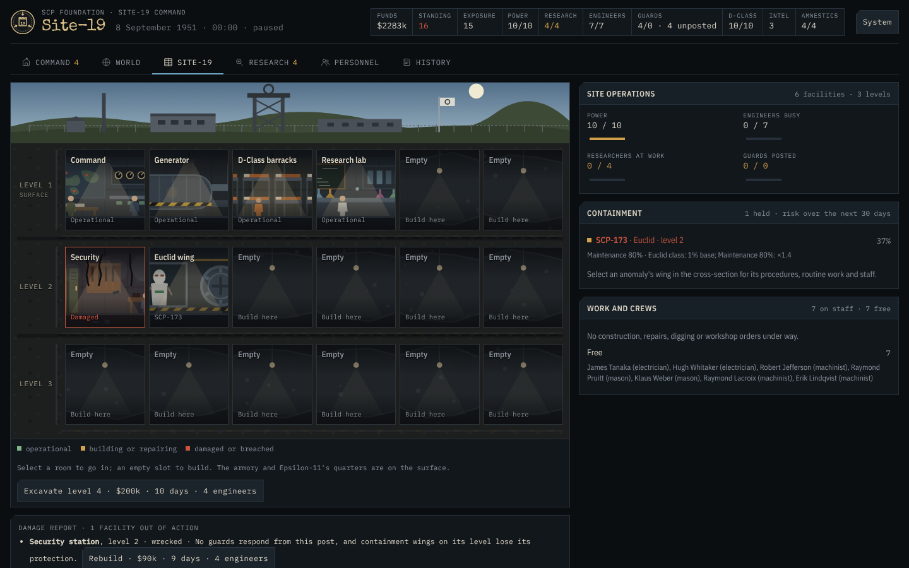
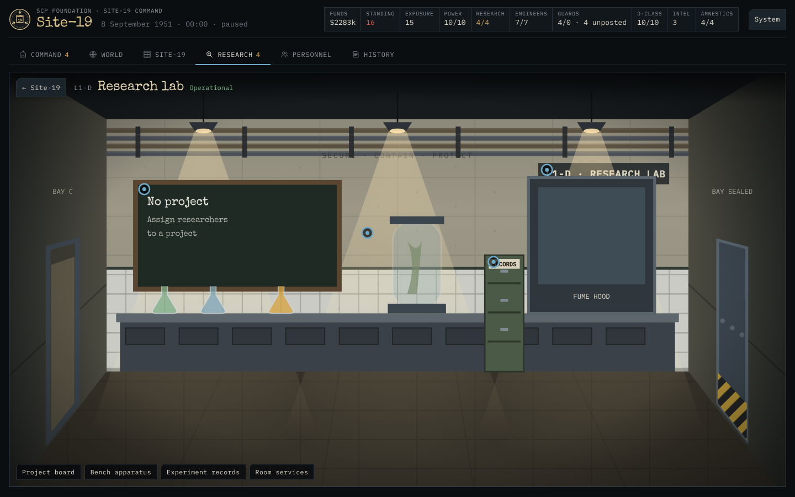
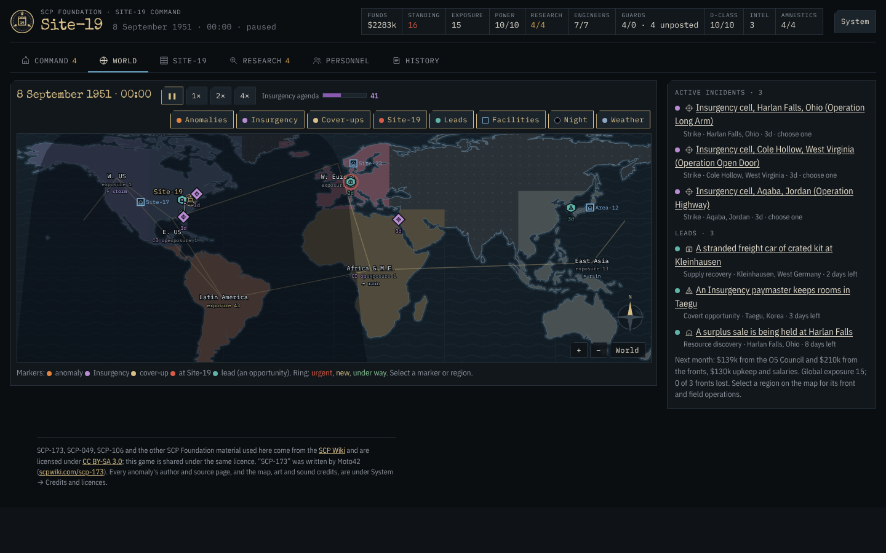

# SCP-X

A turn-based SCP game, inspired by XCOM. You run Site-19 and send Epsilon-11 (Nine-Tailed Fox) out when something breaks containment.

The idea is that each anomaly plays by its own rules, and guns mostly don't solve anything. SCP-173 is the first one in: it can't move while somebody is looking at it, so the whole fight is about who's watching, who's about to blink, and how you get it into a box before the Chaos Insurgency gets in the way.



| | |
|---|---|
|  |  |



## What's in it

- **Missions**: grid-based tactics with cover, overwatch, suppression, darkness and sanity. SCP-173, 049, 106, 610 and a few others each need a different approach.
- **The site**: build out Site-19 floor by floor, keep the D-Class barracks from rioting, clean 173's cell on schedule, and hope nothing breaches.
- **The world**: manage funding from the O5 Council, keep public exposure down with cover stories, and track Insurgency cells across regions.
- **Your people**: operatives rank up, get hurt, lose their nerve, and stay dead.

It's set in 1951 and still very much in progress.

## Playing it

```sh
npm install
npm run dev
```

Then open the URL Vite prints. Saves live in your browser's local storage.

`npm run build` produces a single self-contained `dist/index.html` you can open or host anywhere.

## Tests

```sh
npm run build && npm test
```

Unit tests run in Node. The browser tests need Playwright installed globally. `node tests/run.cjs e2e lab` runs one suite.

There's a debug panel on the backtick key, and a tactical sandbox at `index.html#lab` for poking at line of sight, cover and the enemy AI.

Design notes, roadmaps and progress logs are in [`docs/`](docs).

## Credits

SCP-173 was written by Moto42, SCP-049 by Gabriel Jade, SCP-106 by DrGears. SCP-610's author still needs confirming on [its wiki page](https://scpwiki.com/scp-610). All SCP Foundation material (the Foundation, Site-19, the O5 Council, Epsilon-11, D-Class, the Chaos Insurgency) comes from the [SCP Wiki](https://scpwiki.com) under [CC BY-SA 3.0](https://creativecommons.org/licenses/by-sa/3.0/), and this project uses the same license.

Any new SCP has to credit its authors here and in-game. The 173 figure is a placeholder drawing, since the original sculpture photo isn't covered by the wiki's license.
